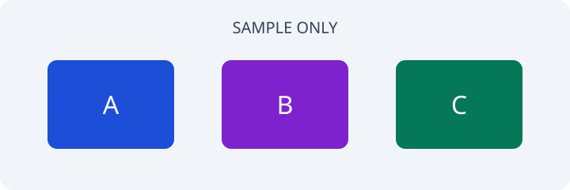

+++
title = 'SAMPLE ONLY: Formatting and image test'
date = '2026-11-01T09:00:00+02:00'
description = 'SAMPLE ONLY. Dummy headings, lists, a table, a quote, and an illustration for theme testing.'
tags = ['sample-only', 'formatting']
+++

**SAMPLE ONLY. Everything on this page is dummy content for testing Hugo themes, not a real post.**

## Text styles

Here is **bold text**, *italic text*, and `inline_code`. This paragraph has no
technical claim; it only demonstrates ordinary Markdown formatting.

Use this sample to compare spacing, line lengths, and the contrast of different themes.

<!--more-->

## Lists

1. Open a sample page.
2. Compare its appearance in another theme.
3. Delete the dummy posts when you are ready to publish real writing.

- First placeholder item
- Second placeholder item
  - A nested placeholder item

## A sample table

These are invented labels, not measurements or benchmark results.

| Placeholder | Example value | Purpose |
| --- | --- | --- |
| Alpha | sample-a | Test a short cell |
| Beta | sample-b | Test another row |
| Gamma | sample-c | Test table spacing |

## A sample quotation

> SAMPLE ONLY: A blockquote should be distinct from the surrounding paragraphs.
> This text has no external source.

## A sample image

The illustration is a placeholder for testing image sizing. It does not depict a
real system.

---

**End of formatting sample. All content above is for theme testing only.**
